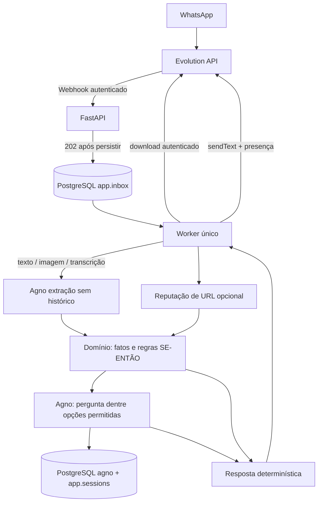

# Sentinela

Sistema especialista híbrido para **triagem de indícios de fraudes digitais pelo WhatsApp**. Projeto acadêmico: Agno e OpenAI interpretam entradas multimodais; regras explícitas e testáveis no domínio classificam o risco. Não garante que uma mensagem é legítima ou fraudulenta.

## Stack e decisões

Python **3.15.2**, Agno **3.2.1**, FastAPI, Pydantic, OpenAI, PostgreSQL 18, Poetry e Docker Compose. Versões-alvo verificadas em 25/11/2026. O modelo padrão é `gpt-5.4-mini`, ajustável por ambiente; a transcrição usa `gpt-transcribe`. Requer acesso aos modelos na conta OpenAI. Nenhuma dependência de Dify ou n8n.



### DDD pragmático

- **domain:** fatos, regras de produção, classificação, perguntas e entidades de mensagem/sessão; não importa SDKs.
- **application:** caso de uso `AnalyzeMessage`, portas `Protocol`, coordenação multimodal e controle da conclusão.
- **infrastructure:** adaptadores Agno/OpenAI, Evolution, reputação e PostgreSQL.
- **interfaces:** API, schemas de eventos e worker; composição de dependências nas bordas.

Um contexto delimitado (triagem de fraude); não há abstrações de microserviços desnecessárias. O motor avalia 12 regras uma vez, sem encadeamento recursivo. `ALTO`, `MODERADO` e `INCONCLUSIVO` são categorias heurísticas, não probabilidades. O agente não pode modificar a classificação nem inventar reputação de URL. As regras e suas fontes são inspecionáveis no código.

## Ativação explícita no WhatsApp

O Sentinela **não responde a uma conversa individual antes do opt-in**. O usuário deve enviar exatamente `Sentinela` (ignorando maiúsculas/minúsculas e espaços externos). O bot responde:

> Sentinela ativo. Envie a mensagem, imagem ou áudio suspeito. Para terminar, envie Encerrar.

A partir daí, texto, fotos, áudios e `/nova` seguem o pipeline de inferência. Ao enviar `Encerrar`, o estado fica inativo e o bot responde:

> Sessão encerrada. Para iniciar novamente, envie Sentinela.

Mensagens seguintes são ignoradas até nova ativação, quando uma **nova sessão** é criada e fatos/perguntas anteriores são apagados. O estado fica persistido por `(instance, wid)` em `app.sessions.active`, com padrão `false`. A transição e a resposta pendente são gravadas na mesma transação PostgreSQL; os comandos e mensagens ignoradas não gastam cota de inferência nem chamam a OpenAI. Confira [docs/optin-deploy.md](docs/optin-deploy.md).

## Executar na VPS

Pré-requisitos: Docker Engine + Compose v2, instância Evolution API v2 existente com suporte a headers personalizados e chave OpenAI. **Na mesma VPS, não há necessidade de expor o webhook publicamente:** use a rede Docker compartilhada. Quando a Evolution estiver fora da rede privada, use um proxy HTTPS. O Postgres não publica portas. A API está vinculada a `127.0.0.1:8080` por padrão; se o proxy for um container, conecte os serviços à rede privada dele e aponte para `api:8080` (não use localhost de outro container).

```bash
cp .env.example .env
chmod 600 .env
# Gere dois segredos distintos e preencha o .env com eles e as chaves reais:
openssl rand -hex 32
openssl rand -hex 32
# O poetry.lock é versionado e verificado pelo Dockerfile e CI.
# Não regenere o lock no servidor: mantenha o arquivo do commit selecionado.
docker network inspect whatsapp_internal >/dev/null 2>&1 || docker network create whatsapp_internal
docker compose config --quiet
docker compose up -d --build
curl -fsS http://127.0.0.1:8080/health/ready
docker compose logs -f worker
```

O Dockerfile exige `poetry.lock` e executa `poetry check --lock` antes da instalação, garantindo que o build use a resolução versionada. Para atualizar versões, gere outro lock com Python 3.15.2 / Poetry 2.2.1 em uma branch e revise as alterações. Em volumes já existentes, `docker-entrypoint-initdb.d` não reexecuta scripts: aplique `db/001_initial.sql` explicitamente se necessário.

### Conectar a Evolution API à rede Docker privada

O `compose.yaml` conecta os serviços **`api` e `worker`** à rede externa `whatsapp_internal`, pois o worker precisa consultar mídias, enviar respostas e atualizar a presença na Evolution API. Apenas `api` define o alias `sentinela-api`. O `db` permanece somente na rede interna do Sentinela. A rede externa é intencionalmente **pré-criada** (Compose não a cria automaticamente).

```bash
docker network inspect whatsapp_internal >/dev/null 2>&1 || docker network create whatsapp_internal
docker compose up -d --build
```

Se a Evolution API roda em **outro projeto Docker Compose da mesma VPS**, adicione ao **serviço da Evolution** a rede externa abaixo, mantendo também as redes que ele já utiliza:

```yaml
services:
  evolution:
    networks:
      - default
      - whatsapp_internal

networks:
  whatsapp_internal:
    name: whatsapp_internal
    external: true
```

O nome `evolution` é ilustrativo: aplique a alteração ao nome real do serviço de sua instalação e recrie-o (`docker compose up -d` na pasta da Evolution). Não substitua outras redes necessárias, nem adicione o banco de dados da Evolution à rede compartilhada.

Para verificar o DNS e a conectividade a partir da rede, use:

```bash
docker run --rm --network whatsapp_internal curlimages/curl:8.11.1 \
  --fail --show-error http://sentinela-api:8080/health/live
```

Depois configure `WEBHOOK_URL=http://sentinela-api:8080/webhooks/evolution` no `.env` **do Sentinela**. Execute `configure_webhook.py --apply` no container **api do Sentinela** (onde está o script), não no da Evolution. Este script requer que `EVOLUTION_API_URL` seja acessível **a partir do container do Sentinela**, além de exigir a chave `EVOLUTION_API_KEY`.

**Política de segurança:** HTTP é permitido somente para o alias `sentinela-api`, porta `8080` e caminho `/webhooks/evolution`; qualquer outro destino HTTP é rejeitado. URLs HTTPS externas continuam permitidas, sem credenciais nem parâmetros no endereço. A autenticação `apikey` permanece obrigatória no webhook. A rede Docker compartilhada não equivale a isolamento criptográfico: dê acesso apenas a containers confiáveis. Não abra a porta 8080 no firewall da VPS.

### Evolution API

Configure `WEBHOOK_URL=http://sentinela-api:8080/webhooks/evolution` quando a Evolution estiver na rede Docker compartilhada (ou `WEBHOOK_URL=https://seu-dominio/webhooks/evolution` para acesso externo). O script abaixo **substitui o webhook previamente configurado** na instância; use uma instância dedicada ou confira se a alteração não interromperá automações existentes.

```bash
docker compose exec api python scripts/configure_webhook.py --apply
# Para versões que registram sob /event/webhook/set:
# docker compose exec api python scripts/configure_webhook.py --apply --route event/webhook/set
```

Configuração: `MESSAGES_UPSERT` + `PRESENCE_UPDATE`, `base64=false`, header HTTP `apikey` com o valor de `WEBHOOK_API_KEY` (diferente da chave de saída `EVOLUTION_API_KEY`). Não é aceita a chave dentro do JSON nem query string. Se sua versão não encaminhar headers customizados, atualize ou use um proxy privado autenticado que injete o header apenas após verificar a origem. Não exponha rota sem autenticação. Verifique o comportamento após reiniciar a Evolution.

| Método e caminho | Finalidade |
|---|---|
| POST `/webhooks/evolution` | Entrada de texto, imagens, áudio e presença |
| POST `/webhooks/evolution/messages-upsert` | Variante com webhook por evento |
| POST `/webhooks/evolution/presence-update` | Evento de presença recebido, ignorado de propósito |
| GET `/health/live` | Processo HTTP ativo |
| GET `/health/ready` | Tabela de inbox acessível |
| POST Evolution `/chat/sendPresence/{instance}` | Digitando/pausado (best effort) |
| POST Evolution `/chat/getBase64FromMediaMessage/{instance}` | Busca mídia por ID de mensagem |
| POST Evolution `/message/sendText/{instance}` | Entrega do resultado em texto |

A mesma rota recebe todos os tipos, conforme o contrato Evolution. Eventos de grupo, status, mensagens do próprio bot e tipos não suportados são ignorados. PNG/JPEG/WebP são validados e redimensionados; áudio OGG/MP3/WAV/M4A/WebM é transcrito. O WID normaliza o remetente individual `@s.whatsapp.net`; identificadores `@lid` permanecem separados até que exista uma associação verificada, evitando misturar históricos de usuários. O envio a `@lid` depende da versão da Evolution.

A presença é melhor esforço, não um indicador contínuo durante toda a análise. A API devolve 202 após gravar o evento e não fica aguardando OpenAI. O worker usa uma trava PostgreSQL e fila persistente, processamento serial, três tentativas de análise, deduplicação por `(instance,message_id)` e estado `uncertain` para envio ambíguo. Não há promessa de entrega exatamente uma vez: um operador deve verificar a conversa antes de reenviar manualmente.

## Sessões, privacidade e limites

- `app.sessions`: um usuário por instância/WID, UUID estável, UUID por caso, fatos presentes/negados e última pergunta. `/nova` inicia um novo caso, não apaga histórico antigo.
- `agno`: tabelas criadas pelo Agno, histórico apenas de categorias, IDs de regras e perguntas. A etapa de extração não possui DB Agno. Fotos e áudios são processados em memória; os textos e legendas recebidos ficam temporariamente na inbox até a análise. A OpenAI recebe conteúdo bruto necessário à análise; informe os participantes e use exemplos sintéticos. Evite enviar senhas, documentos ou códigos reais.
- Inbox concluída elimina payload e resposta; deduplicação preservada por sete dias; pendências expiram em 24h quando o worker estiver ativo. Histórico Agno e sessões não têm expurgo automático nesta versão: planeje retenção/exclusão antes de uso com dados reais. Backups também podem conter dados anteriores.
- URLs suspeitas não são abertas. O adaptador opcional Google Safe Browsing envia somente URL sem query/fragmento/credenciais, mas o caminho ainda pode conter dados sensíveis; ativação explícita, uso não comercial e cobertura limitada. Um resultado negativo nunca prova segurança. URLs apenas em imagem não são consultadas externamente.
- Prompt injection é mitigada por separação de dados, schema restrito, nenhuma ferramenta de execução na extração e decisão final determinística; não há garantia absoluta contra interpretação incorreta pela LLM.
- Uma instância e um worker por deploy. Sem painel, contas web, RAG, OCR independente ou frontend. Não é um produto de segurança certificado. Configure rate limiting no proxy e restrinja a origem se possível.

## Desenvolvimento e validação

```bash
poetry install
poetry run pytest -q
poetry run ruff check src tests scripts --select E4,E7,E9,F
poetry run mypy src/sentinela/domain src/sentinela/application
```

A CI executa testes, lint, mypy estrito no domínio/aplicação e smoke de importação dos adaptadores. Os testes locais usam fakes e HTTP mock, sem custos de API. Há também teste de integração PostgreSQL em CI (`RUN_POSTGRES_TESTS=1`), ainda não executado. Docker, dependências nas versões-alvo e WhatsApp/OpenAI reais ainda precisam ser validados. Ver `docs/evidencias.md` para roteiro e `docs/validacao.md` para o que foi efetivamente executado.

## Publicar no GitHub

O pacote inclui um Git bundle com a branch `main` e um commit inicial. Se estiver usando o ZIP de código, inicialize o Git antes. Após gerar `poetry.lock` e revisar o `.env`:

```bash
git init -b main                 # só se estiver usando o ZIP sem .git
git add .
git commit -m "feat: setup inicial do Sentinela"
gh auth login
gh repo create marcelomatheus/sentinela --private --source=. --remote=origin --push
```

A visibilidade sugerida é privada até a entrega acadêmica; altere para pública somente se desejar. Nunca adicione `.env` ou credenciais. Se usar o bundle, clone-o e execute somente os comandos de publicação e o commit adicional do lock.

## Referências

- CERT.br, Cartilha de Segurança para Internet: https://cartilha.cert.br/fasciculos/
- Python: https://www.python.org/downloads/release/python-3152/
- Agno: https://pypi.org/project/agno/ e https://docs.agno.com/
- Agno PostgreSQL: https://docs.agno.com/database/providers/postgres/overview
- Evolution API: https://github.com/evolution-foundation/evolution-api
- OpenAI transcrição: https://developers.openai.com/api/docs/guides/speech-to-text
- Google Safe Browsing v4: https://developers.google.com/safe-browsing/v4

As regras são adaptações didáticas dos padrões de alerta, não transcrições das cartilhas nem regras validadas estatisticamente.

### Compatibilidade da Evolution API 2.3.7

O script `scripts/configure_webhook.py` usa `byEvents: false` e `base64: false` dentro do objeto `webhook`. Esta nomenclatura foi verificada no DTO da release 2.3.7; outras versões/documentações podem expor nomes diferentes. Nomes Unicode de instância, como `meu-número`, são aceitos e percent-encoded nos caminhos HTTP, sem permitir barras ou espaços.
